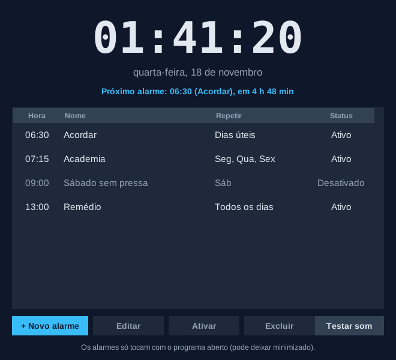
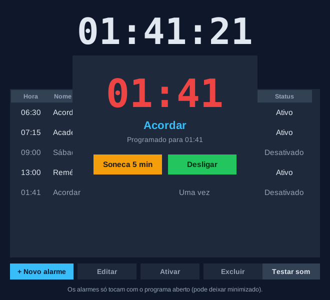

# Despertador

Despertador para o computador, com vários alarmes, repetição por dia da semana e soneca. Funciona no **Windows, Linux e macOS** e não precisa instalar nenhuma biblioteca: só Python.

| Tela principal | Alarme tocando |
|---|---|
|  |  |

## Funcionalidades

- **Relógio** grande com a data por extenso e a contagem para o próximo alarme ("em 4 h 48 min").
- **Vários alarmes**, cada um com horário, nome e dias da semana. Atalhos para *Uma vez*, *Dias úteis*, *Fim de semana* e *Todos os dias*.
- **Alarme de uma vez**: sem nenhum dia marcado, toca uma vez e se desativa sozinho.
- **Ativar/desativar** um alarme sem precisar apagar.
- **Janela de alarme** que aparece por cima das outras, com o horário piscando e aviso sonoro a cada segundo:
  - **Soneca 5 min**: toca de novo daqui a 5 minutos;
  - **Desligar**: encerra o toque.
  - Sem resposta em 10 minutos, o toque para sozinho e o aviso fica na tela principal.
- **Alarmes salvos** em `~/.despertador.json`, que voltam ao abrir o programa.
- **Não perde alarme** se a verificação atrasar alguns segundos, e não toca de uma vez os alarmes perdidos depois que o computador sai da suspensão.
- **Teclado na lista**: duplo clique edita, `Delete` exclui, `Espaço` ativa/desativa.

> Os alarmes só tocam com o programa aberto. Pode deixar a janela minimizada; ao fechar com alarmes ativos, o programa avisa.

## Requisitos

- Python 3.9 ou mais novo, com Tkinter (já vem no instalador oficial do Windows e do macOS).
  - No Ubuntu/Debian, se faltar: `sudo apt install python3-tk`

## Como usar

```bash
git clone https://github.com/thi-araujo/Despertador.git
cd Despertador
python despertador.py
```

No Linux/macOS, use `python3` no lugar de `python`.

Para abrir junto com o Windows, crie um atalho para `pythonw despertador.py` na pasta que abre com **Win + R → `shell:startup`**. O `pythonw` abre o programa sem a janela preta do terminal.

## Estrutura do projeto

```
Despertador/
├── despertador.py       # interface gráfica (Tkinter)
├── alarmes.py           # lógica: alarmes, repetição, soneca e arquivo de configuração
├── tests/
│   └── test_alarmes.py  # testes automatizados
└── docs/                # capturas de tela usadas neste README
```

A lógica fica separada da interface, então `alarmes.py` pode ser usado sozinho:

```python
from datetime import datetime
from alarmes import Agenda, Alarme

agenda = Agenda()
agenda.adicionar(Alarme(hora="06:30", rotulo="Acordar", dias=[0, 1, 2, 3, 4]))
print(agenda.proximo(datetime.now()))
```

## Testes

Os testes passam datas fixas para as funções, então não dependem do horário em que são executados:

```bash
python -m unittest discover -s tests -v
```

## Histórico

Este repositório nasceu em 2022 como cópia de outro projeto (Calculadora Científica e um contador regressivo) e não tinha código de despertador. Em 2026 ganhou o aplicativo de alarmes com interface gráfica e testes. A calculadora continua no repositório próprio: [Calculadora_Cientifica](https://github.com/thi-araujo/Calculadora_Cientifica). O contador virou o [Cronometro_](https://github.com/thi-araujo/Cronometro_).

## Autor

**Thiago Gomes Araújo**: [GitHub](https://github.com/thi-araujo) · [Portfólio](https://thi-araujo.github.io)
